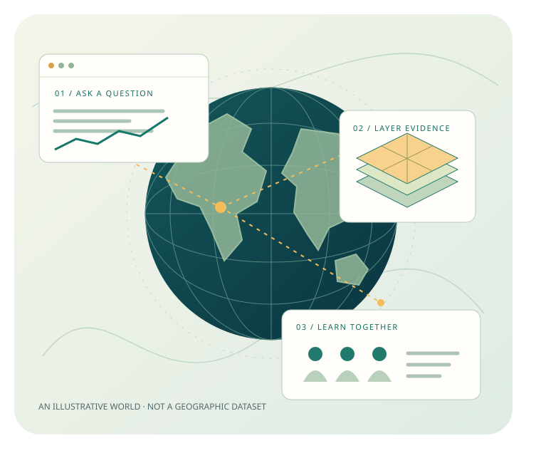
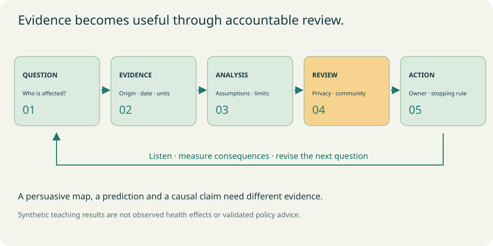
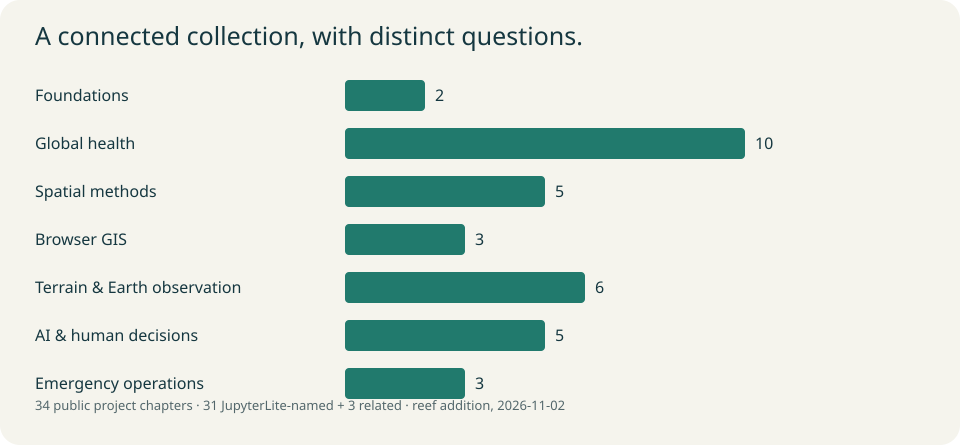

# JupyterLite Learning Atlas

**James L. Tobias / browser geospatial science, global health and shared decisions**



A growing index of public JupyterLite projects, a Jupyter Book and a matching browser-executable JupyterLite Lab. Follow six paths through GIS, remote sensing, Earth observation, AI/ML, GeoAI/GeoML, global health and human-centered experiments. Every project has a distinct explained exercise, visual output, interpretation, extension and source citation.

**30 public JupyterLite-named repositories + 3 related browser projects / 33 project chapters / 42 canonical notebooks / no credentials for default exercises.** The public inventory was inspected on 2026-11-01. The four requested source repositories are now public and included; the refreshed discovery contains 59 public records. Original, revised and old editions remain distinct. The title-only Shiny repository is labeled a source stub. No sensitive health data are published.

## Read, run and explore

The source visibility changes are complete. GitHub Actions builds and publishes this index from `main`; see the [publication workflow](https://github.com/jltobias/JupyterLite-Index-Repo/actions/workflows/pages.yml) for the latest build and deployment status. Source companion availability is recorded independently.

Use the published entry points below. Availability follows the latest successful Pages deployment:

| Experience | Published link | What you do |
|---|---|---|
| Learning hub | [Open the atlas](https://jltobias.github.io/JupyterLite-Index-Repo/) | Choose a question and a learning path |
| Jupyter Book | [Read the Book](https://jltobias.github.io/JupyterLite-Index-Repo/book/index.html) | Read explanations and executed outputs |
| JupyterLite Lab | [Run the same notebooks](https://jltobias.github.io/JupyterLite-Index-Repo/lite/lab/index.html?path=index.ipynb) | Edit assumptions and run Python in a browser |
| Resource explorer | [Search the collection](https://jltobias.github.io/JupyterLite-Index-Repo/explore/) | Filter exact Book, Lab, 2D map, 3D map, scene and explorer links |
| Local teaching views | [2D map](https://jltobias.github.io/JupyterLite-Index-Repo/teach/?view=2d) / [3D map](https://jltobias.github.io/JupyterLite-Index-Repo/teach/?view=3d-map) / [3D scene](https://jltobias.github.io/JupyterLite-Index-Repo/teach/?view=3d-scene) | Change a water threshold on a fictional grid; compare interpretations |

For a local preview, build the site, run `python scripts/serve.py`, and open [localhost](http://localhost:8000/JupyterLite-Index-Repo/).

## Published companion experiences

These **existing source projects** returned HTTP 200 on 2026-11-01. Entry reachability does not verify every notebook path or interaction; their own dependencies and terms apply.

| Source experience | Verified source link |
|---|---|
| Rewiring Global Health Book | [Read the original course](https://jltobias.github.io/JupyterLite-Rewiring-Global-Health/) |
| Rewiring Global Health Lab | [Run the original lessons](https://jltobias.github.io/JupyterLite-Rewiring-Global-Health/lite/lab/index.html) |
| RustGIS companion 2D map | [Open the 2D map](https://jltobias.github.io/JupyterLite-RustGIS/maps/2d.html) |
| RustGIS companion 3D map | [Open the extruded 3D map](https://jltobias.github.io/JupyterLite-RustGIS/maps/3d.html) |
| RustGIS companion 3D scene | [Open the orbitable scene](https://jltobias.github.io/JupyterLite-RustGIS/maps/scene.html) |
| STAC resource explorer | [Discover source catalog metadata](https://jltobias.github.io/JupyterLite-STAC-Browser/explorer/) |

This index's entry points: [hub](https://jltobias.github.io/JupyterLite-Index-Repo/), [Book](https://jltobias.github.io/JupyterLite-Index-Repo/book/index.html), [Lab](https://jltobias.github.io/JupyterLite-Index-Repo/lite/lab/index.html?path=index.ipynb), [explorer](https://jltobias.github.io/JupyterLite-Index-Repo/explore/), and [local teaching views](https://jltobias.github.io/JupyterLite-Index-Repo/teach/). The workflow status records whether the latest revision has deployed successfully.

## Six connected paths

1. **Start with a browser:** Python foundations / original Shiny-stub prototype / [fit and evaluate a small model](content/foundations/learning-a-model.ipynb) / Data Visualization / PyScript / RustGIS.
2. **Read a map critically:** neighborhoods / inclusive distance buffers / layer contracts / aggregation / extract provenance; compare distinct original, revised and old public spatial-analysis editions.
3. **Observe a changing Earth:** procedural terrain / viewing geometry / Whitebox runtime boundary / STAC / Ocean Watch / Zarr/SQL and Earth studios.
4. **Rewire global health:** stakeholder priorities / burden denominators / HIVDB / climate/coastal services / mobility and community review.
5. **Inspect AI and decisions:** fitted models / Six Hats / structured JSON / spatial holdouts / evidence contracts / research discovery. Explore [design thinking, human-centered design and fail-fast iteration](content/foundations/evidence-ai.ipynb).
6. **Build a common picture:** World Monitor / WorldView / OSIRIS; verify uncertain signals before briefing.

## Rewiring Global Health in the Age of AI

The featured [source course](https://github.com/jltobias/JupyterLite-Rewiring-Global-Health) connects evidence, climate/STAC, 2D/3D GIS, GeoLibre, time, Zarr/SQL, GeoAI/world models, AI orchestration, digital twins and geoprivacy. Its [atlas chapter](content/projects/rewiring-global-health/index.ipynb) preserves **all ten original lesson run links** and adds a stakeholder-weighting exercise. The [synthesis notebook](content/synthesis/global-health.ipynb) connects the wider collection to privacy, empathy, human authority and reversible experimentation.



Synthetic teaching results are not real health evidence, causal effects, treatment guidance or live AI outputs. Models, masked locations and encryption do not replace consent, validation or community review.

## Public project catalog

The links below open canonical notebooks on GitHub. The assembled Book and Lab use those exact notebooks. Source links lead to the actual repositories; immutable reviewed READMEs, resource types, status dates and limitations are in the [catalog](catalog/repositories.json). No hosted URL is guessed when a README lacks one. Shiny-Live-Apps contains only a title-only README; its atlas notebook is an original prototype, with no source app or source Lab claimed. The Maps-and-Spatial-Analyses README launcher is retained exactly and labeled HTTP 404 (2026-11-01). The other three new sources document no hosted launcher.

| Public JupyterLite source | Atlas exercise | Status |
|---|---|---|
| [JupyterLite-Data-Visualization](https://github.com/jltobias/JupyterLite-Data-Visualization) | [See the same evidence two ways](content/projects/data-visualization/index.ipynb) | learning companion |
| [JupyterLite-Shiny-Live-Apps](https://github.com/jltobias/JupyterLite-Shiny-Live-Apps) | [Prototype a reactive rule before an app](content/projects/shiny-live-apps/index.ipynb) | source stub |
| [JupyterLite-South-Sudan-Dashboard](https://github.com/jltobias/JupyterLite-South-Sudan-Dashboard) | [Service continuity as a dependency](content/projects/south-sudan-dashboard/index.ipynb) | learning companion |
| [JupyterLite-Spatial-Analysis](https://github.com/jltobias/JupyterLite-Spatial-Analysis) | [Neighborhoods change a summary](content/projects/spatial-analysis/index.ipynb) | synthetic methods edition |
| [JupyterLite-Maps-and-Spatial-Analyses](https://github.com/jltobias/JupyterLite-Maps-and-Spatial-Analyses) | [A buffer is a declared rule](content/projects/maps-and-spatial-analyses/index.ipynb) | map-centric edition |
| [JupyterLite-Geospatial-Analyses-and-Maps-old](https://github.com/jltobias/JupyterLite-Geospatial-Analyses-and-Maps-old) | [A teaching extract is not a census](content/projects/geospatial-analyses-and-maps-old/index.ipynb) | old edition |
| [JupyterLite-Geospatial-Analyses-and-Maps](https://github.com/jltobias/JupyterLite-Geospatial-Analyses-and-Maps) | [Overlay with an explicit layer contract](content/projects/geospatial-analyses-and-maps/index.ipynb) | original variant |
| [JupyterLite-Geospatial-Analyses-and-Maps-revised](https://github.com/jltobias/JupyterLite-Geospatial-Analyses-and-Maps-revised) | [Show what aggregation hides](content/projects/geospatial-analyses-and-maps-revised/index.ipynb) | revised variant |
| [JupyterLite-Global-Health-GIS](https://github.com/jltobias/JupyterLite-Global-Health-GIS) | [Weight burden without hiding assumptions](content/projects/global-health-gis/index.ipynb) | learning companion |
| [JupyterLite-HIVDB-Drug-Resistance-Maps](https://github.com/jltobias/JupyterLite-HIVDB-Drug-Resistance-Maps) | [Audit the surveillance denominator](content/projects/hivdb-drug-resistance-maps/index.ipynb) | learning companion |
| [JupyterLite-Whitebox](https://github.com/jltobias/JupyterLite-Whitebox) | [Trace downhill, then change runtimes](content/projects/whitebox/index.ipynb) | learning companion |
| [JupyterLite-AI-Agents-and-Orchestrator-Six-Thinking-Hats](https://github.com/jltobias/JupyterLite-AI-Agents-and-Orchestrator-Six-Thinking-Hats) | [Route perspectives before synthesis](content/projects/ai-agents-and-orchestrator-six-thinking-hats/index.ipynb) | learning companion |
| [JupyterLite-DRC-Population-Mobility-Border-Mapping](https://github.com/jltobias/JupyterLite-DRC-Population-Mobility-Border-Mapping) | [Flows are connections, not infections](content/projects/drc-population-mobility-border-mapping/index.ipynb) | learning companion |
| [JupyterLite-Geospatial-Research-Awareness-Radar](https://github.com/jltobias/JupyterLite-Geospatial-Research-Awareness-Radar) | [Rank leads without endorsing claims](content/projects/geospatial-research-awareness-radar/index.ipynb) | learning companion |
| [JupyterLite-World-Monitor-Prototype](https://github.com/jltobias/JupyterLite-World-Monitor-Prototype) | [Put freshness in the situation report](content/projects/world-monitor-prototype/index.ipynb) | learning companion |
| [JupyterLite-Astra-demos](https://github.com/jltobias/JupyterLite-Astra-demos) | [Procedural terrain, transparent assumptions](content/projects/astra-demos/index.ipynb) | learning companion |
| [JupyterLite-Gods-Eye-View-Satellite](https://github.com/jltobias/JupyterLite-Gods-Eye-View-Satellite) | [Inspect the viewing geometry](content/projects/gods-eye-view-satellite/index.ipynb) | learning companion |
| [JupyterLite-WorldView](https://github.com/jltobias/JupyterLite-WorldView) | [Allocate supplies with visible constraints](content/projects/worldview/index.ipynb) | learning companion |
| [JupyterLite-Custom-GPT-Six-Thinking-Hats](https://github.com/jltobias/JupyterLite-Custom-GPT-Six-Thinking-Hats) | [Validate a structured conversation](content/projects/custom-gpt-six-thinking-hats/index.ipynb) | learning companion |
| [JupyterLite-GeoLibre-GeoAI](https://github.com/jltobias/JupyterLite-GeoLibre-GeoAI) | [Check a spatial holdout](content/projects/geolibre-geoai/index.ipynb) | learning companion |
| [JupyterLite-GPT-6-Astra-Geospatial](https://github.com/jltobias/JupyterLite-GPT-6-Astra-Geospatial) | [Evaluate claims against a contract](content/projects/gpt-6-astra-geospatial/index.ipynb) | learning companion |
| [JupyterLite-zarr-sql-views](https://github.com/jltobias/JupyterLite-zarr-sql-views) | [Query a cube, account for the work](content/projects/zarr-sql-views/index.ipynb) | learning companion |
| [JupyterLite-Global-Fishing-Watch-and-Dark-Vessels](https://github.com/jltobias/JupyterLite-Global-Fishing-Watch-and-Dark-Vessels) | [Observe vessels, preserve uncertainty](content/projects/global-fishing-watch-and-dark-vessels/index.ipynb) | learning companion |
| [JupyterLite-Rewiring-Global-Health](https://github.com/jltobias/JupyterLite-Rewiring-Global-Health) | [Rewiring Global Health in the Age of AI](content/projects/rewiring-global-health/index.ipynb) | learning companion |
| [JupyterLite-Sea-Level-Rise](https://github.com/jltobias/JupyterLite-Sea-Level-Rise) | [Separate hazard from service impact](content/projects/sea-level-rise/index.ipynb) | learning companion |
| [JupyterLite-STAC-Browser](https://github.com/jltobias/JupyterLite-STAC-Browser) | [Discover assets without reading pixels](content/projects/stac-browser/index.ipynb) | learning companion |
| [JupyterLite-Climate-and-Health](https://github.com/jltobias/JupyterLite-Climate-and-Health) | [Count heat exposure, preserve uncertainty](content/projects/climate-and-health/index.ipynb) | learning companion |
| [JupyterLite-RustGIS](https://github.com/jltobias/JupyterLite-RustGIS) | [Export a small layer with a contract](content/projects/rustgis/index.ipynb) | learning companion |
| [JupyterLite-Osiris](https://github.com/jltobias/JupyterLite-Osiris) | [Turn signals into a reviewed brief](content/projects/osiris/index.ipynb) | learning companion |
| [JupyterLite-PyScript](https://github.com/jltobias/JupyterLite-PyScript) | [One data contract, two browser runtimes](content/projects/pyscript/index.ipynb) | learning companion |

## Related browser projects

These source READMEs explicitly describe JupyterLite/JupyterGIS material without a JupyterLite-prefixed name.

| Source | Atlas exercise | Source boundary |
|---|---|---|
| [JupyterGIS-StoryMap-Gaborone-TB-ABM](https://github.com/jltobias/JupyterGIS-StoryMap-Gaborone-TB-ABM) | [Storytelling needs a residual check](content/projects/jupytergis-storymap-gaborone-tb-abm/index.ipynb) | No published launch URL in README; source only |
| [Cross-Border-Ebola-Risk-Mapping-Prototype](https://github.com/jltobias/Cross-Border-Ebola-Risk-Mapping-Prototype) | [Sensitivity before a risk label](content/projects/cross-border-ebola-risk-mapping-prototype/index.ipynb) | No published launch URL in README; source only |
| [global-informal-settlements-storymap](https://github.com/jltobias/global-informal-settlements-storymap) | [A settlement label needs evidence](content/projects/global-informal-settlements-storymap/index.ipynb) | README links checked as indicated |

## Build and expand

```bash
python -m venv .venv
# Windows: .venv\Scripts\Activate.ps1
# macOS/Linux: source .venv/bin/activate
python -m pip install -r requirements-build.txt
python scripts/generate.py
python scripts/validate.py
python scripts/execute.py --write
python scripts/build.py
python scripts/serve.py
```

Use Python 3.13. This pins the stable Jupyter Book v1/Sphinx renderer (maintenance mode) and JupyterLite stack; Node is unnecessary. First-time browser runtime downloads need network. Computations use bundled synthetic values or metadata; no learner package installs or remote data services. Native/GPU tools and live model providers have explicit separate continuation paths and trial limits in each relevant chapter. Download notebook edits to keep them; browser storage is not GitHub or a shared database.

To publish, set repository **Settings / Pages / Source: GitHub Actions**, then run the supplied workflow on `main`. Pull requests validate/build without deploying. Exactly four source visibility changes were authorized and completed; their public audit is in [catalog/public-visibility-changes.json](catalog/public-visibility-changes.json). Commits pushed to `main` run the [validation and deployment workflow](https://github.com/jltobias/JupyterLite-Index-Repo/actions/workflows/pages.yml). See [CONTRIBUTING.md](CONTRIBUTING.md) for catalog schema, preservation of manual notebook edits, build/preview commands, runtime limits and publication setup. See [VALIDATION.md](VALIDATION.md) for actual verification and remaining limits.



## Citations, rights and provenance

[Full references](REFERENCES.md) / [Data provenance](DATA_SOURCES.md) / [Visual provenance](assets/PROVENANCE.md) / [Third-party notices](THIRD_PARTY_NOTICES.md) / [Citation metadata](CITATION.cff).

Original code is [MIT](LICENSE); original narrative, visuals, figures and synthetic fixtures are [CC BY 4.0](LICENSE-CONTENT.md). Source repositories, concepts, data, software distributions and linked works retain their own terms. Cite James L. Tobias and contributors (2026), *JupyterLite Learning Atlas*, plus the original projects/data used. Original SVGs are locally bundled, accessible and reproducible from `scripts/make_assets.py`; no third-party imagery is copied.

## Ocean Watch and Earth studios: sources and attribution

The new [Ocean Watch chapter](content/projects/global-fishing-watch-and-dark-vessels/index.ipynb) retains ambiguity in an original synthetic AIS–SAR candidate screen and links all nine source notebooks. [Zarr/SQL](content/projects/zarr-sql-views/index.ipynb) keeps its chunk exercise and adds interval/missing-coverage accounting, with all thirty source lessons and representative studio views. Neither fixture copies source data or runs source SQL or LexCube. Activity is not catch, stock, disease or proof of illegal fishing; embeddings, predicted fields and conditional projections require independent interpretation.

- **Source courses:** James L. Tobias / jltobias (2026), *Ocean Watch: Fishing, Dark Vessels & One Health*, [commit `145a73e500cb`](https://github.com/jltobias/JupyterLite-Global-Fishing-Watch-and-Dark-Vessels/blob/145a73e500cb06070f399a040206802cc279174e/README.md); and *Earth in the Browser*, [commit `9a191f1fd30c`](https://github.com/jltobias/JupyterLite-zarr-sql-views/blob/9a191f1fd30c40e09b48b9f92a9b5fdd9676509e/README.md). The Earth course builds on [dzole0311's *Zarr SQL Views*](https://github.com/dzole0311/zarr-sql-views) (ISC); its original lessons/artwork remain ISC. Full [Ocean sources](https://github.com/jltobias/JupyterLite-Global-Fishing-Watch-and-Dark-Vessels/blob/145a73e500cb06070f399a040206802cc279174e/content/sources.md) and [Earth credits](https://github.com/jltobias/JupyterLite-zarr-sql-views/blob/9a191f1fd30c40e09b48b9f92a9b5fdd9676509e/book/credits.md) retain provider terms.
- **Ocean research:** Paolo, F. S., Kroodsma, D., Raynor, J., et al. (2024), *Satellite mapping reveals extensive industrial activity at sea*, Nature **625**, 85–91, [paper](https://doi.org/10.1038/s41586-023-06825-8). Paolo, Kroodsma, Davis & Hochberg's [analysis-data deposit](https://doi.org/10.6084/m9.figshare.24309475.v4), version 4, covers 2017–2021 and is **CC BY 4.0**. This differs from GFW's inspected [platform terms](https://globalfishingwatch.org/terms-of-use/), **CC BY-NC 4.0**; follow each product's metadata. [NOAA NCEI OISST v2.1](https://www.ncei.noaa.gov/products/optimum-interpolation-sst), [Copernicus Sentinel-1 RTC / Microsoft Planetary Computer](https://planetarycomputer.microsoft.com/dataset/sentinel-1-rtc) and [Natural Earth (public domain)](https://www.naturalearthdata.com/about/terms-of-use/) are credited source-course inputs, not copied index inputs. The source also credits [FAO's 2025 marine fishery assessment](https://www.fao.org/newsroom/detail/fao-releases-the-most-detailed-global-assessment-of-marine-fish-stocks-to-date) and [ICEYE's dark-vessel discussion](https://www.iceye.com/blog/dark-vessels-in-northern-europe-and-how-iceyes-satellites-find-them); no report graphics or vendor imagery are reproduced. [WHO/OHHLEP One Health principles](https://www.who.int/publications/m/item/one-health-definitions-and-principles) frame the ecosystem/health questions.
- **SeasFire:** Alonso, L., Gans, F., Karasante, I., et al. (2024), *SeasFire Cube*, **v0.4**, [dataset](https://doi.org/10.5281/zenodo.13834057), **CC BY 4.0**; Karasante et al. (2025), *SeasFire cube — a multivariate dataset for global wildfire modeling*, Scientific Data **12**, 368, [paper](https://doi.org/10.1038/s41597-025-04546-3). Credit the SeasFire consortium/ESA, [JRC/GWIS](https://gwis.jrc.ec.europa.eu/), [ECMWF/Copernicus ERA5](https://doi.org/10.24381/cds.adbb2d47), [NASA MODIS MOD13C1 v6](https://doi.org/10.5067/MODIS/MOD13C1.006) and ESA EarthCODE/CloudFerro.
- **LexCube:** Söchting, M., Scheuermann, G., Montero, D., & Mahecha, M. D. (2025), *Interactive Earth system data cube visualization in Jupyter notebooks*, Big Earth Data **9(2)**, **321–335**, [paper](https://doi.org/10.1080/20964471.2025.2471646). [LexCube **2.0.1**](https://github.com/msoechting/lexcube), Maximilian Söchting and contributors, **GPL-3.0-or-later**; credit RSC4Earth/Leipzig University and ESA DeepESDL/DFG NFDI4Earth. [Source-course adaptation/source/license](https://jltobias.github.io/JupyterLite-zarr-sql-views/vendor/lexcube/README.md). This index embeds no LexCube binaries; source ISC does not replace GPL.
- **Global FTW:** Robinson, C., Muhawenayo, G., Khanal, S., et al. (2026), *The first global agricultural field boundary map at 10 m resolution*, [arXiv:2605.11055](https://doi.org/10.48550/arXiv.2605.11055). [Global Fields of the World](https://source.coop/ftw/global-data), alpha **2024/2025**, **CC BY 4.0**: Taylor Geospatial and collaborators, Microsoft AI for Good, participating universities, Copernicus Sentinel-2, Source Cooperative/Radiant Earth. Predictions do not establish parcels or ownership.
- **TESSERA:** Feng, Z., et al. (2025; revised 2026), *TESSERA: Temporal Embeddings of Surface Spectra for Earth Representation and Analysis*, [arXiv:2506.20380](https://doi.org/10.48550/arXiv.2506.20380). Credit TESSERA/University of Cambridge, dClimate inference/hosting and GeoTessera contributors. Source data **v1.1 / dClimate** are explicitly **CC0** under the [terms](https://github.com/ucam-eo/tessera/blob/master/aup.md); legacy inconsistent CC-BY wording is retained upstream and ethical guidance is advisory. GeoTessera code is MIT.
- **AR6:** Garner et al. (2021), *IPCC AR6 Sea Level Projections*, **v20210809**, [dataset](https://doi.org/10.5281/zenodo.5914709), **CC BY 4.0**; Fox-Kemper et al. (2021), WG1 Chapter 9, [DOI](https://doi.org/10.1017/9781009157896.011); Kopp et al. (2023), *FACTS v1.0*, GMD **16**, 7461–7489, [DOI](https://doi.org/10.5194/gmd-16-7461-2023). Credit the projection authors, supporting funders and NASA Sea Level Change Team; retain the [pinned Rutgers guide](https://github.com/Rutgers-ESSP/IPCC-AR6-Sea-Level-Projections/tree/8ee75128d8f6d9a8ba9825f47c92d11955d0651e). Scenarios have no assigned probabilities; workflow percentiles are not the assessed p-box.

These datasets, code, pixels, model weights and source graphics are **linked, not bundled**. Index fixtures and SVGs are original (CC BY 4.0); original executable code is MIT. See [REFERENCES.md](REFERENCES.md), [DATA_SOURCES.md](DATA_SOURCES.md) and [THIRD_PARTY_NOTICES.md](THIRD_PARTY_NOTICES.md) for the rights/use distinctions and complete provider references. No institutional endorsement is implied.
